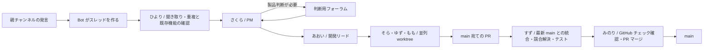

# Tonarium Agent Studio

Discord の声を聞き取り、GitHub PR の作成・チェック・`main` へのマージまで進める常駐エージェントです。対象は `.env` の `DISCORD_CHANNEL_ID` で指定した通常のテキストチャンネルです。親チャンネルへ発言すると Bot がそのメッセージから公開スレッドを作り、ひよりが詳細を聞きます。ユーザーが手動で作ったスレッドも受け付けます。

Tonarium リポジトリの既定ブランチ名は `master` ではなく **`main`** です。案件ごとに最初の発言を受けた時点の `main` commit を保存し、その commit の worktree で既存機能を調べ、実装します。後から `main` が進んでも、最初の判断に使ったコードは変わりません。



似た声は既存案件にまとめます。リポジトリの実ファイルを確認できる既存機能は使い方を返信して閉じます。製品判断が必要な案件だけ判断用フォーラムに投稿します。フォーラム ID が未設定の場合は元のスレッドで質問します。

ユーザーの発言と Bot の返答は、同じスレッドに **日本語・英語・韓国語**を併記します。元の発言は消しません。判断用フォーラムの会話も翻訳します。翻訳が失敗しても元の発言の聞き取りは続けます。

実装担当は最大 3 件を並列処理します。各案件で `npm ci`、`npm run typecheck`、`npm run build`、`npm run test:client`、`npm run test:sync` を通してから PR を作ります。すずは PR ブランチへ最新 `main` を取り込み、競合を解決し、統合状態で同じチェックを実行します。みのりは GitHub の Web チェックの成功を待ち、PR の head commit を確認して `main` にマージします。チェックが現れない場合もマージしません。複数 PR は一件ずつ最新 `main` へ合わせます。

## セットアップ

Node.js 22.13 以降、Git、GitHub CLI (`gh`)、Claude Code CLI が必要です。Codex CLI はこのプロジェクトに `@openai/codex` を固定しており、システムの古い CLI に依存しません。既定では Claude Max と ChatGPT/Codex のサブスクログインを使い、AI 用 API キーを子プロセスへ渡しません。

```powershell
cd C:\Users\neo\GitHub\tonarium-agent
Copy-Item .env.example .env  # まだ .env がない場合だけ
npm ci
npm run doctor
npm start
```

既存の `.env` はそのまま使えます。旧 `NIGHTLY_BRANCH` と `COOLIFY_*` は現在の出荷フローでは参照しません。必要な設定は次の通りです。

| 設定 | 内容 |
| --- | --- |
| `DISCORD_TOKEN` | Discord Bot token。Developer Portal で Message Content Intent を有効にする。 |
| `DISCORD_CHANNEL_ID` | フィードバック用テキストチャンネル。`.env` で指定します。 |
| `DISCORD_DECISION_FORUM_ID` | 任意。判断だけを投稿するフォーラムの ID。 |
| `DISCORD_DECISION_MENTION_ID` | 任意。判断投稿で呼ぶユーザー ID。 |
| `TONARIUM_REPO` | Tonarium の既存 checkout。初期値 `C:\Users\neo\GitHub\tonarium-prototype`。 |
| `GITHUB_REPO` | `katteni-kaihatu/tonarium-prototype`。`gh auth login` の書き込み権限が必要。 |
| `RELEASE_BRANCH` | `main`。 |
| `PLANNING_PROVIDER` | 聞き取り・PM・リード・出荷に使う `claude` または `codex`。 |
| `CODING_PROVIDER` / `INTEGRATION_PROVIDER` | 実装・競合解決に使う `codex` または `claude`。 |
| `CODEX_MODEL` / `CODEX_SPEED` | 既定は `gpt-6.1-sol` / `fast`。この PC でサブスクログインによる応答を確認済み。 |
| `TRANSLATION_PROVIDER` | 既定は `claude`（サブスク）。`openai` を選ぶと翻訳だけ OpenAI API を使う。 |
| `TRANSLATION_MODEL` | OpenAI API 翻訳時のモデル。既定は `gpt-6-luna`。 |
| `OPENAI_API_KEY` | `TRANSLATION_PROVIDER=openai` の場合だけ必要。Codex の聞き取り・実装には渡さない。 |
| `RELEASE_BATCH_MINUTES` | PR をまとめる待ち時間。既定 `0`（準備完了後、次の15秒巡回で出荷開始）。 |
| `REQUIRED_PR_CHECK` | GitHub で成功を待つチェック名。既定 `web`。 |

すでに出荷待ちの PR を即時処理する場合は、Bot を止めずに `npm run release:ready` を実行できます。出荷担当が最新 `main` への統合、ローカルテスト、GitHub チェック、PR マージを順番に行います。

Bot には対象チャンネルで **View Channel、Read Message History、Create Public Threads、Send Messages in Threads** を与えてください。判断用フォーラムを使う場合は投稿権限も必要です。Message Content Intent の詳細は [Discord の公式資料](https://github.com/discord/discord-api-docs/blob/main/developers/events/gateway.mdx) を参照してください。

Codex の `gpt-6.1-sol` と Fast モードは [OpenAI Docs のモデル情報](https://learn.chatgpt.com/docs/models#gpt-61-sol) と [速度設定](https://learn.chatgpt.com/docs/agent-configuration/speed#fast-mode) に従っています。Fast はサブスクの利用枠を通常の 2.5 倍消費します。`CODEX_SPEED=standard` にすれば通常速度にできます。

OpenAI API 翻訳は [Responses API の Structured Outputs](https://developers.openai.com/api/docs/guides/structured-outputs#structured-outputs-vs-json-mode) で日英韓の三項目を受け取ります。API 方式を選んだ場合、翻訳対象の発言は OpenAI API に送信されます。

## ダッシュボードと常駐

ダッシュボードはローカルの `http://127.0.0.1:43879` と公開 URL `https://tonarium-agent.kokopi.me` で見られます。担当者、案件の段階、最近の動き、PR マージ履歴をライブ更新します。公開 URL はこの PC からの SSH 逆トンネルを使用します。PC、Bot、トンネルのどれかが停止すると公開も停止します。画面には Discord の案件名・要約・活動内容が表示されます。

Windows ログオン時の起動タスクは `.env` を設定した後に登録できます。

```powershell
powershell -ExecutionPolicy Bypass -File .\scripts\install-startup-task.ps1
powershell -ExecutionPolicy Bypass -File .\scripts\install-public-tunnel-task.ps1
Start-ScheduledTask -TaskName TonariumAgent
Start-ScheduledTask -TaskName TonariumAgentTunnel
```

`.data/state.sqlite` に案件、受信時の `main` commit、出荷履歴を保存します。`.worktrees/` は一時的な作業コピーです。これらと `.env` は Git に含めません。
