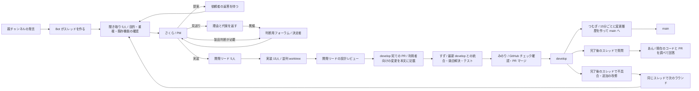

# Tonarium Agent Studio

エージェント共通の運用方針は `WORKFLOW.md`、実装・提案・見送りの判断基準は `policy/guardrails.md`、担当別の指示は `prompts/` にあります。対象リポジトリの開発の方向性は、そのリポジトリの `docs/direction.md` を作業コピーから読みます。Bot は Codex または Claude Code を呼ぶ直前に読み直すため、文章の変更は再起動せず次の実行から反映されます。設計の参考にした OSS と今後の改善点は [オーケストレーション調査](docs/orchestration-references.md)にまとめています。

Discord の声を聞き取り、GitHub PR の作成・チェック・`develop` へのマージと、15分ごとの `main` への反映まで進める常駐エージェントです。対象は `.env` の `DISCORD_CHANNEL_ID` で指定した通常のテキストチャンネルです。親チャンネルへ発言すると Bot がそのメッセージから公開スレッドを作り、空いている聞き取り担当が詳細を聞きます。ユーザーが手動で作ったスレッドも受け付けます。

Tonarium リポジトリの既定ブランチは `main` ですが、この Bot の開発先は **`develop`** です。案件ごとに最初の発言を受けた時点の `develop` commit を保存し、その commit の worktree で既存機能を調べ、実装します。後から `develop` が進んでも、最初の判断に使ったコードは変わりません。



似た声は既存案件にまとめます。リポジトリの実ファイルを確認できる既存機能は使い方を返信して閉じます。聞き取りは依頼の条件だけでなく目的（誰が・どの場面で・何に困っているか）を確かめます。PM と開発リードも受付時点の `develop` の作業コピーを読み、PM は依頼を「実装する／提案する／見送る／人の判断に回す」のどれにするかを判断基準に沿って決めます。

- **提案**：推定した目的と案をスレッドに出し、依頼者の返答を待ちます（スレッド名は「💡 提案中」）。
- **見送り**：理由と代わりの案を返します（スレッド名は「🚫 見送り」）。依頼者が異議を書くと判断用フォーラムに回り、`DISCORD_DECISION_MENTION_ID` の人の回答だけで決まります。設計レビューで判断基準に当たる変更が見つかった場合も同じです。
- **人の判断**：製品判断が必要な案件だけ判断用フォーラムに投稿します。通常の判断は、フォーラムでも元のスレッドでも回答できます。フォーラム ID が未設定の場合は元のスレッドで質問します。

実装担当の差分は、PR にする前に開発リードが目的・方針・判断基準に照らして確認し、指摘があれば一度直します。

返事を待って止まるとき（聞き取りの質問、提案、見送り、仕様の確認、2回失敗後の指示待ち、判断依頼）だけ、相手にメンションします。進捗の報告にはメンションしません。どの状態でも、スレッドに書かれた発言には必ず返事をします。実装待ち・実装中の発言は作業への追加指示として PR の前に反映し、`develop` へのマージ作業中の発言はマージ後に続けて対応します。停止した案件への発言は次の指示として聞き取り直します。

聞き取り担当は Codex のサブスクログインを使います。Discord のスレッドに添付された PNG・JPEG 画像を新しい順に最大4枚、各10 MiBまで一時取得し、`codex exec --image` の視覚入力として渡します。処理後に一時ファイルを消します。対応外の形式や取得できない画像は URL を会話履歴に残し、画像内容を確認したものとしては扱いません。画像入力の方法は [公式 OpenAI Docs](https://learn.chatgpt.com/docs/image-inputs?surface=cli) に従っています。

ユーザーの発言と Bot の返答は、同じスレッドで **日本語・英語・韓国語**にそろえます。翻訳は原文の言語を除いた行だけを国旗付きで出し、見出しは付けません（日本語の発言なら 🇺🇸 と 🇰🇷 の2行）。原文の言語が3言語のどれでもない場合は3行とも出します。元の発言は消しません。判断用フォーラムの会話も翻訳します。翻訳が失敗しても元の発言の聞き取りは続けます。

投稿は Discord の Webhook 経由で、投稿者ごとの名前とアイコンにします。担当の返答は「さくら｜PM」のような名前と担当のアイコン（`public/avatars/<担当 ID>.png` を GitHub の公開 URL から読み込み）、参加者の発言の翻訳はその参加者のサーバーでの表示名とアイコンで出ます。どちらも Discord では「アプリ」の印が付きます。Bot は各チャンネルに「Tonarium Agent」（担当用）と「Tonarium Agent 通訳」（翻訳用）の2つの Webhook を自動で作ります。Webhook を使えない場合は、Bot 本人の名前で本文の先頭に担当名を付けて投稿します。マージ後や既存機能の案内後も同じスレッドで質問できます。実装案内の「あん」が PR と現在のコードを確認し、質問には回答します。不具合・回帰・追加の改修依頼なら、**同じスレッドで次のラウンド**として聞き取りから再開します。前回の要約・受け入れ条件・PR・会話（Bot の返答も含む）を引き継ぐので、前提を説明し直す必要はありません。前回のラウンドは `ticket_rounds` に残ります。再現情報が足りなければ同じスレッドで質問します。

Discord のスレッド名には現在の案件状態を「🛠️ 実装中｜件名」「✅ developへマージ済み｜件名」「✅ mainに反映済み｜件名」のように絵文字と日本語で表示します。以前 `main` へ入れた案件はそのまま `main` と表示します。Discord の変更回数制限で更新できない場合は、保存された状態に合わせて再試行します。Web ボードにも状態の絵文字を表示し、失敗した案件は「要対応」欄に残します。

Bot が停止していた間に完了済みスレッドへ届いた質問も、再起動時に完了時刻と最終発言を比べて拾います。個別のスレッドで実装案内をすぐ動かすには `npm run answer:thread -- <Discord スレッド ID>` を使います。

実装担当は最大 15 件を並列処理します。変更履歴（`changelog/`・`shared/changelog.ts`）は書かず、利用者向けの変更を PR 本文の「利用者向けの変更」に書きます。履歴を編集してしまった場合は、テスト前に元へ戻します。各案件で `npm ci`、`npm run typecheck`、`npm run build`、`npm run test:client`、`npm run test:sync` を通してから PR を作ります。すずは PR ブランチへ最新 `develop` を取り込み、競合を解決し、統合状態で同じチェックを実行します。みのりは GitHub の Web チェックと実行対象のワークフローすべての完了を待ち、PR の head commit を確認して `develop` にマージします。チェックが現れない場合もマージしません。複数 PR は一件ずつ最新 `develop` へ合わせます。

## セットアップ

Node.js 22.13 以降、Git、GitHub CLI (`gh`) が必要です。Codex CLI はこのプロジェクトに `@openai/codex` を固定しています。既定では受付、PM、リード、実装、出荷、通訳の全員が ChatGPT/Codex のサブスクログインを使い、AI 用 API キーを子プロセスへ渡しません。`claude` を明示的に選んだ場合だけ Claude Code CLI が必要です。

```powershell
cd C:\Users\neo\GitHub\tonarium-agent
Copy-Item .env.example .env  # まだ .env がない場合だけ
npm ci
npm run doctor
npm start
```

既存の `.env` を使う場合は `RELEASE_BRANCH=develop` に変更してください。旧 `NIGHTLY_BRANCH` と `COOLIFY_*` は現在の出荷フローでは参照しません。必要な設定は次の通りです。

| 設定 | 内容 |
| --- | --- |
| `DISCORD_TOKEN` | Discord Bot token。Developer Portal で Message Content Intent を有効にする。 |
| `DISCORD_CHANNEL_ID` | フィードバック用テキストチャンネル。`.env` で指定します。 |
| `DISCORD_DECISION_FORUM_ID` | 任意。判断だけを投稿するフォーラムの ID。 |
| `DISCORD_DECISION_MENTION_ID` | 任意。判断投稿で呼ぶユーザー ID。見送りへの異議と、判断基準に当たる変更の判断は、この人の回答だけで決まります。未設定なら異議は受け付けません。 |
| `DISCORD_RELEASE_CHANNEL_ID` | 任意。`main` への反映結果を投稿するチャンネル。止まったときは `DISCORD_DECISION_MENTION_ID` の人にメンションします。未設定なら投稿しません。 |
| `TONARIUM_REPO` | Tonarium の既存 checkout。初期値 `C:\Users\neo\GitHub\tonarium-prototype`。 |
| `GITHUB_REPO` | `katteni-kaihatu/tonarium-prototype`。`gh auth login` の書き込み権限が必要。 |
| `RELEASE_BRANCH` | `develop`。PR のマージ先。 |
| `MAIN_BRANCH` / `MAIN_RELEASE_INTERVAL_MINUTES` | 任意。`develop` を反映する先（既定 `main`）と間隔（既定 `15` 分、`0` で停止）。 |
| `INTAKE_PROVIDER` | 聞き取り5人に使う `codex` または `claude`。既定 `codex`。 |
| `PLANNING_PROVIDER` | PM・リード・出荷・実装案内に使う `codex` または `claude`。既定 `codex`。 |
| `CODING_PROVIDER` / `INTEGRATION_PROVIDER` | 実装・競合解決に使う `codex` または `claude`。 |
| `CODEX_MODEL` / `CODEX_SPEED` | 既定は `gpt-6.1-sol` / `fast`。この PC でサブスクログインによる応答を確認済み。 |
| `TRANSLATION_PROVIDER` | 既定は `codex`（サブスク）。`openai` を選ぶと翻訳だけ OpenAI API を使う。 |
| `TRANSLATION_MODEL` | OpenAI API 翻訳時のモデル。既定は `gpt-6-luna`。 |
| `OPENAI_API_KEY` | `TRANSLATION_PROVIDER=openai` の場合だけ必要。Codex の聞き取り・実装には渡さない。 |
| `MAX_WORKERS` | 同時に動く実装担当の上限。既定 `15`。聞き取りとリードは各5人。 |
| `RELEASE_BATCH_MINUTES` | PR をまとめる待ち時間。既定 `0`（準備完了後、次の15秒巡回で出荷開始）。 |
| `REQUIRED_PR_CHECK` | GitHub で成功を待つチェック名。既定 `web`。 |
| `AUTO_RELEASE` | Bot 内蔵の出荷巡回。独立した `TonariumAgentRelease` を使う構成では `false`。 |

独立した出荷タスクが15秒ごとに出荷待ちの PR を確認します。同じタスクが15分ごとにリリース担当（つむぎ）を起動し、`develop` を `main` に反映します。

1. `origin/main..origin/develop` に変更がなければ何もしません。
2. 開始時点の `develop` の commit を固定し、範囲内の PR（Bot の PR・人の PR）と PR を通さない commit を集めます。PR 本文の「利用者向けの変更」を優先し、記載が少なければタイトル・本文・差分から作ります。
3. 機能ごとの `changelog/YYYY-MM-DD-rel<時刻>-<名前>.json` を作ります。利用者に見えない変更は「開発・保守」の一項目にまとめます。旧運用で履歴を含んだまま `develop` に入った PR は記録済みとして扱います。
4. `main` からリリース用ブランチを作り、固定した commit をマージして履歴を加え、`main` 宛ての PR を作ります。GitHub チェックが通ったらマージし、含まれた案件のスレッド名を「mainに反映済み」にします。

失敗したら PR を残して止め、同じ理由の通知は一度だけ送ります。`develop` が進むと PR を作り直します。履歴ファイルは `main` にだけ入り、`develop` には戻しません。`npm run release:main -- --dry-run` で、push や PR 作成をせずに対象範囲と生成される履歴を表示できます。すでに出荷待ちの PR を手動で即時処理する場合は `npm run release:ready` を実行できます。出荷担当が最新 `develop` への統合、ローカルテスト、GitHub チェック、PR マージを順番に行います。

一時的な GitHub push 失敗は同じコミットを再送します。それでも失敗した場合や実装テストで失敗した場合は、PM がエラーと作業ツリーを確認して再作業を指示します。出荷段階で同じPRが2回失敗した場合は、PMがCIログを調べて統合担当に修正を指示します。PMの修正指示を2回試しても解決しない場合や人の判断が必要な場合は自動再試行を止め、スレッドの投稿者にメンションして次の指示を聞きます。回答後は同じPRから再開できます。Tonarium 本体の Web checks は、`develop` 宛ての PR が変更履歴に触れると失敗させます。出荷時に PR が履歴を含んでいた場合は、統合担当が取り消してからチェックを実行します。統合後のテスト失敗も統合担当が修正と再検証を行い、1件の失敗でほかの出荷待ち PR が止まらないようにします。

Bot には対象チャンネルで **View Channel、Read Message History、Create Public Threads、Send Messages in Threads、Manage Webhooks** を与えてください。判断用フォーラムとリリース通知チャンネルにも、投稿権限と Manage Webhooks が必要です。Message Content Intent の詳細は [Discord の公式資料](https://github.com/discord/discord-api-docs/blob/main/developers/events/gateway.mdx) を参照してください。

Codex の `gpt-6.1-sol` と Fast モードは [OpenAI Docs のモデル情報](https://learn.chatgpt.com/docs/models#gpt-61-sol) と [速度設定](https://learn.chatgpt.com/docs/agent-configuration/speed#fast-mode) に従っています。Fast はサブスクの利用枠を通常の 2.5 倍消費します。`CODEX_SPEED=standard` にすれば通常速度にできます。

OpenAI API 翻訳は [Responses API の Structured Outputs](https://developers.openai.com/api/docs/guides/structured-outputs#structured-outputs-vs-json-mode) で原文の言語と日英韓の三項目を受け取ります。API 方式を選んだ場合、翻訳対象の発言は OpenAI API に送信されます。

## ダッシュボードと常駐

ダッシュボードはローカルの `http://127.0.0.1:43879` と公開 URL `https://tonarium-agent.kokopi.me` で見られます。担当者、案件の段階、最近の動き、PR マージ履歴をライブ更新します。公開 URL はこの PC からの SSH 逆トンネルを使用します。PC、Bot、トンネルのどれかが停止すると公開も停止します。画面には Discord の案件名・要約・活動内容が表示されます。

Windows ログオン時の起動タスクは `.env` を設定した後に登録できます。

```powershell
powershell -ExecutionPolicy Bypass -File .\scripts\install-startup-task.ps1
powershell -ExecutionPolicy Bypass -File .\scripts\install-public-tunnel-task.ps1
powershell -ExecutionPolicy Bypass -File .\scripts\install-release-task.ps1
Start-ScheduledTask -TaskName TonariumAgent
Start-ScheduledTask -TaskName TonariumAgentTunnel
Start-ScheduledTask -TaskName TonariumAgentRelease
```

`.data/state.sqlite` に案件、受信時の `develop` commit、ラウンドごとの PR、出荷履歴を保存します。新しい列とテーブルは起動時に自動で追加します。

判断基準やプロンプトを変えたときは、`npm run eval:verdicts -- 10` で保存済みの最新10件に PM の判定だけをやり直して表示できます。案件・Discord・GitHub には書き込みません（AI の利用枠は使います）。`.worktrees/` は作業コピーです。実装中に Bot が再起動した場合は残った作業コピーと GitHub Issue を再利用します。これらと `.env` は Git に含めません。
