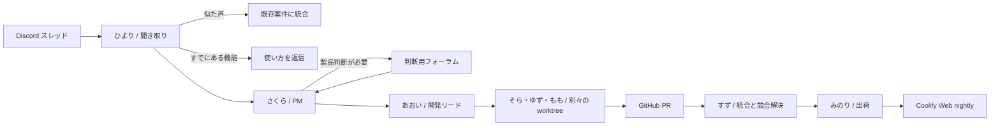

# Tonarium Agent Studio

Discord のフィードバックを AI チームが聞き取り、Tonarium の Web nightly まで届ける常駐オーケストレーターです。対象は通常のテキストチャンネル `1561758758776864838` に作られたスレッドです。チームの状況はローカルのダッシュボードに表示します。

## 動き方



- **ひより**はスレッドで足りない情報を聞きます。既存案件を照合し、リポジトリを読み取って既存機能かも判断します。既存機能として閉じる場合は根拠ファイルの存在を確認します。
- **さくら**は要望を整理し、重複をまとめ、製品判断が必要な点だけ判断用フォーラムへ投稿します。フォーラムを設定しない間は元のスレッドで質問します。
- **あおい**は作業範囲と受け入れ条件を確認します。
- **そら・ゆず・もも**は最大 3 件の案件を並行して実装します。各案件は Tonarium リポジトリの別 worktree です。
- **すず**は PR をまとめて統合し、競合を解決して、統合後のブランチに対してテストを実行します。
- **みのり**は最大 30 分単位で公開候補をまとめ、`agent/web-nightly` に反映して Coolify を起動します。Coolify のデプロイ状態、デプロイされた commit、nightly URL の応答を確認してから Discord に公開を報告します。

オーケストレーター自身はこの独立したフォルダで動きます。worktree が必要なのは **同じ Tonarium コードを同時に編集する実装・統合作業**です。Tonarium の普段の `main` と既存の作業用 worktree は使いません。

## セットアップ

Node.js 22.13 以降、Git、GitHub CLI (`gh`)、Codex CLI、Claude Code CLI を用意してください。この PC では `gh`、Claude、Codex のログインがすでに確認できています。既定の `AGENT_AUTH_MODE=subscription` では **Claude Max と ChatGPT/Codex のサブスク枠**で CLI を実行し、モデルの子プロセスから API キー環境変数を外します。OpenAI / Anthropic の API キーは不要です。このアプリは常駐するローカルプロセスです。

```powershell
cd C:\Users\neo\GitHub\tonarium-agent
Copy-Item .env.example .env
npm install
npm run doctor
npm start
```

`.env` に次を設定します。

| 項目 | 設定内容 |
| --- | --- |
| `DISCORD_TOKEN` | Discord Bot token。Developer Portal で **Message Content Intent** を有効化します。対象チャンネルとスレッドの閲覧、履歴閲覧、投稿権限も与えます。 |
| `DISCORD_CHANNEL_ID` | フィードバック用テキストチャンネル。初期値は `1561758758776864838`。 |
| `DISCORD_DECISION_FORUM_ID` | 任意。製品判断を頼むフォーラムのチャンネル ID。Bot が投稿できる権限が必要です。 |
| `DISCORD_DECISION_MENTION_ID` | 任意。判断投稿で呼ぶ担当者の **ユーザー ID**。 |
| `TONARIUM_REPO` | Tonarium の既存 Git checkout。初期値は `C:\Users\neo\GitHub\tonarium-prototype`。 |
| `PLANNING_PROVIDER` | 聞き取り・PM・リード・出荷に使う `claude` または `codex`。 |
| `CODING_PROVIDER` / `INTEGRATION_PROVIDER` | 実装・競合解決に使う `codex` または `claude`。 |
| `AGENT_AUTH_MODE` | `subscription` が既定。各 CLI のログインを使います。 |
| `CODEX_MODEL` | この PC の ChatGPT ログインで動作確認した `gpt-5.6-sol` を既定にしています。 |
| `COOLIFY_DEPLOY_WEBHOOK` | **Web nightly 専用アプリ**の認証付きデプロイ Webhook。 |
| `COOLIFY_API_TOKEN` | Coolify の API token。デプロイ起動と状態取得に必要です。 |
| `COOLIFY_API_BASE` | Coolify のオリジン。例 `https://coolify.example.com`。`/api/v1` は付けません。 |
| `NIGHTLY_URL` | 公開後に HTTP 応答を確認する Web nightly の URL。 |

名前は `TONARIUM_TEAM_NAMES` の JSON で変更できます。例: `{"pm":"花子","release":"太郎"}`。

Coolify には **専用の Web nightly アプリ**を作り、Git リポジトリを `katteni-kaihatu/tonarium-prototype`、ブランチを `agent/web-nightly` に設定してください。既存の Dockerfile / Compose 構成を使います。Coolify 側の Git push 自動デプロイは無効にし、このエージェントの Webhook を公開トリガーにしてください。nightly ブランチは最初の実装時に `origin/main` から作成されます。既存の native / Electron nightly の GitHub Actions は触りません。

Bot の参加先では、通常のテキストチャンネル内にスレッドを作ってフィードバックを書きます。スレッド本文が曖昧なら、ひよりが同じスレッドで聞き返します。フォーラムは開発タスクの一覧には使わず、製品判断が必要な時だけ使います。

## ダッシュボードと常駐

既定の URL は `http://127.0.0.1:43879` です。担当者、案件の段階、最近の動き、出荷履歴がライブ更新されます。Discord token を入れるまでは **SETUP MODE** と表示されます。ダッシュボードにはフィードバックの要約が出るため、外部公開する場合は認証付きのプロキシを置いてください。

Windows ログオン時に起動するタスクを登録するには、`.env` を完成させてから次を実行します。

```powershell
powershell -ExecutionPolicy Bypass -File .\scripts\install-startup-task.ps1
Start-ScheduledTask -TaskName TonariumAgent
```

実行状態は `npm run doctor` とダッシュボードで確認できます。ログオン前から常時動かす構成にする場合は、同じプロセスを専用ホストに移してサービスとして運用してください。`.data/state.sqlite` は案件と出荷履歴、`.worktrees/` は一時的な Git checkout です。これらと `.env` は Git に含めません。

## 出荷条件

各実装 worktree と統合候補 worktree で `npm ci`、`npm run typecheck`、`npm run build`、`npm run test:client`、`npm run test:sync` を通します。失敗した案件は止めて Discord とダッシュボードに表示します。Coolify の設定がまだない場合は PR を出荷待ちに保持します。デプロイの受付だけで「公開済み」とは記録しません。

現在の実装では、Bot token、AI 認証、Coolify Webhook / API token / nightly URL が入力されるまでライブの Discord と Coolify には接続できません。ローカルのダッシュボードと状態管理は認証情報なしでも起動できます。

## 技術メモ

Discord のスレッドイベントと Message Content Intent は [Discord の公式資料](https://github.com/discord/discord-api-docs/blob/main/developers/events/gateway.mdx) に従っています。Coolify は [deploy webhook](https://coolify.io/docs/core/automation/deploy-webhooks) と [デプロイ状態 API](https://coolify.io/docs/api/endpoints/deployments/get-deployment-by-uuid) を使います。GitHub Actions の `GITHUB_TOKEN` で作成した PR はワークフローが自動実行されない場合があるため、この構成はローカルの `gh` 認証と統合 worktree の実テストを公開条件にしています（[GitHub の仕様](https://docs.github.com/en/actions/how-tos/write-workflows/choose-when-workflows-run/trigger-a-workflow)）。

[GitHub Agentic Workflows](https://docs.github.com/en/copilot/concepts/agent-capabilities/agent-powered-workflows-and-operations/about-github-agentic-workflows) も Codex / Claude を実行できる OSS の選択肢です。このプロトタイプは、Discord の会話を継続して聞き取り、複数案件を一か所で束ねる常駐状態を必要とするため、専用の Node.js オーケストレーターにしています。
